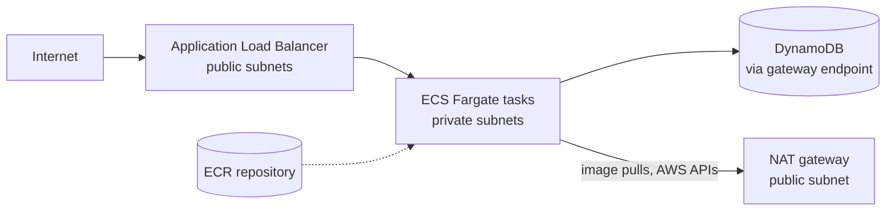
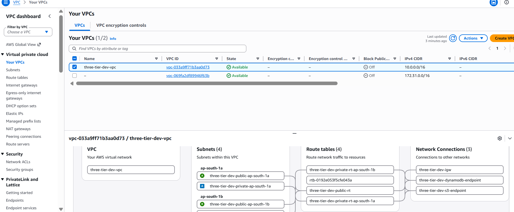
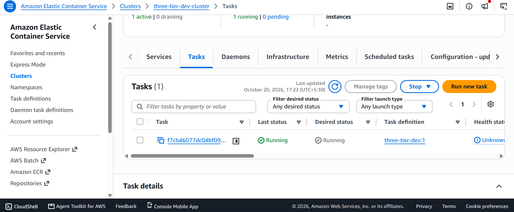
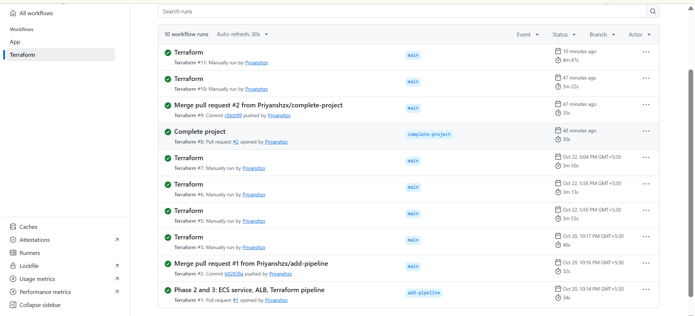

# Terraform AWS Three-Tier Architecture

A three-tier AWS architecture defined entirely as code with Terraform and deployed through a GitHub Actions pipeline that authenticates with OIDC (no stored AWS keys). Region: `ap-south-1` (Mumbai).

**Status:** Phases 1 to 3 complete. Next: run a real application image and add a security scan.

## Architecture



| Tier | Resources |
|---|---|
| Network | VPC across 2 AZs, public and private subnets, internet gateway, NAT gateway, S3 and DynamoDB gateway endpoints |
| Application | Application Load Balancer, ECS cluster, Fargate service, ECR repository, CloudWatch logs |
| Data | DynamoDB table (on-demand) |

## Phase 1: VPC



- VPC `10.0.0.0/16`, two public and two private subnets in two Availability Zones
- Private subnets have no direct route from the internet
- Free gateway endpoints keep S3 and DynamoDB traffic off the NAT gateway
- NAT gateway is controlled by a variable because it bills hourly
- Remote state in S3 with native locking, bootstrapped separately

## Phase 2: Compute




- ALB in the public subnets, Fargate tasks in the private subnets with no public IPs
- Task security group accepts traffic only from the ALB security group
- Separate task execution role and task role (least privilege)
- CPU-based auto-scaling: 1 to 3 tasks, target 60% CPU
- ECR repository with scan-on-push, logs in CloudWatch (7-day retention)
- The service currently runs a public nginx image as a smoke test of the infrastructure

## Phase 3: Delivery pipeline



| Trigger | What runs | AWS role |
|---|---|---|
| Pull request | `terraform fmt -check`, `validate`, `plan` | Read-only role |
| Manual run on `main` | `plan`, `apply`, or `destroy` | Apply role |
| Merge to `main` | `plan` (and `apply` only if the repo variable `AUTO_APPLY` is `true`) | Read-only role |

- GitHub OIDC federation, no long-lived credentials in GitHub
- The apply role's trust policy only accepts the `main` branch of this repository
- Apply is manual by default so an idle stack never keeps billing

## Cost

A running stack costs roughly **$0.11 per hour** (NAT gateway, ALB, three public IPv4 addresses, one small Fargate task). Run `destroy` when you finish a session. Everything is recreated from code in about 8 minutes.

## Structure

```
bootstrap/        state bucket and the IAM roles used by GitHub Actions
modules/vpc/      VPC, subnets, routing, NAT, gateway endpoints
modules/alb/      load balancer, target group, listener, security group
modules/ecs-service/   ECR, cluster, task definition, service, IAM, auto-scaling
envs/dev/         dev environment that wires the modules together
.github/workflows/terraform.yml   plan / apply / destroy pipeline
```

## Usage

```bash
cd bootstrap && terraform init && terraform apply   # once
cd ../envs/dev
terraform init
terraform plan
terraform apply
terraform destroy   # when finished, to avoid charges
```

Requires Terraform 1.10 or newer and AWS credentials configured locally.

## Roadmap

- [x] Phase 1: VPC, subnets, routing, gateway endpoints
- [x] Phase 2: ALB, ECS Fargate service, ECR, DynamoDB, auto-scaling
- [x] Phase 3: GitHub Actions pipeline with OIDC
- [ ] Phase 4: run a real application image from ECR
- [ ] Phase 5: security scan with checkov, cost notes from the AWS bill
