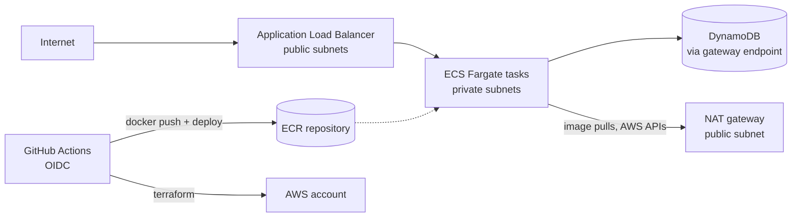
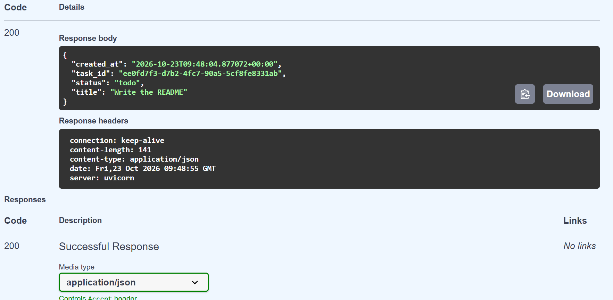

# Terraform AWS Three-Tier Architecture

A three-tier AWS architecture defined entirely as code with Terraform, running a containerized FastAPI task tracker, and deployed through GitHub Actions pipelines that authenticate with OIDC (no stored AWS keys). Region: `ap-south-1` (Mumbai).

## Architecture



| Tier | Resources |
|---|---|
| Network | VPC across 2 AZs, public and private subnets, internet gateway, NAT gateway, S3 and DynamoDB gateway endpoints |
| Application | Application Load Balancer, ECS cluster, Fargate service, ECR repository, CloudWatch logs |
| Data | DynamoDB table (on-demand) |

## Phase 1: Network


- VPC `10.0.0.0/16`, two public and two private subnets in two Availability Zones
- Free gateway endpoints keep S3 and DynamoDB traffic off the NAT gateway
- NAT gateway is controlled by a variable because it bills hourly
- Remote state in S3 with native locking, bootstrapped separately

## Phase 2: Compute


- ALB in the public subnets, Fargate tasks in private subnets with no public IPs
- Task security group accepts traffic only from the ALB security group
- Separate task execution role and task role (least privilege, DynamoDB access scoped to one table)
- CPU-based auto-scaling: 1 to 3 tasks, target 60% CPU
- ECR repository with scan-on-push, logs in CloudWatch (7-day retention)

## Phase 3: Infrastructure pipeline


| Trigger | What runs | AWS role |
|---|---|---|
| Pull request | `terraform fmt -check`, `validate`, `plan`, checkov scan | Read-only role |
| Manual run on `main` | `plan`, `apply`, or `destroy` | Apply role |
| Merge to `main` | `plan` (and `apply` only if the repo variable `AUTO_APPLY` is `true`) | Read-only role |

- GitHub OIDC federation, no long-lived credentials in GitHub
- The apply role's trust policy only accepts the `main` branch of this repository
- Apply is manual by default so an idle stack never keeps billing

## Phase 4: Application



A FastAPI task tracker (`app/`) packaged with a multi-stage Dockerfile that runs as a non-root user.

| Method | Path | Description |
|---|---|---|
| GET | `/health` | Load balancer health check |
| POST | `/tasks` | Create a task |
| GET | `/tasks` | List tasks |
| GET | `/tasks/{task_id}` | Get one task (404 if missing) |
| PUT | `/tasks/{task_id}` | Update status: `todo`, `in_progress`, `done` |
| DELETE | `/tasks/{task_id}` | Delete a task |

The **App** workflow tests the code with mocked AWS calls on every pull request. On `main` it builds the image, pushes it to ECR (tagged with the commit SHA and `latest`), forces a new ECS deployment, and waits for the service to become stable.

## Security and cost

- A checkov scan runs on every pull request in report-only mode
- A running stack costs roughly **$0.11 per hour** (NAT gateway, ALB, public IPv4 addresses, one small Fargate task). The stack is destroyed after each session and recreated from code in about 8 minutes.

## Structure

```
app/                         FastAPI task tracker, Dockerfile, tests
bootstrap/                   state bucket and the IAM roles used by GitHub Actions
modules/vpc/                 VPC, subnets, routing, NAT, gateway endpoints
modules/alb/                 load balancer, target group, listener, security group
modules/ecs-service/         ECR, cluster, task definition, service, IAM, auto-scaling
envs/dev/                    dev environment that wires the modules together
.github/workflows/terraform.yml   fmt / validate / plan / checkov, manual apply and destroy
.github/workflows/app.yml         test, build, push to ECR, deploy
```

## Usage

```bash
cd bootstrap && terraform init && terraform apply   # once
cd ../envs/dev
terraform init
terraform plan
terraform apply
terraform destroy   # when finished, to avoid charges
```

Requires Terraform 1.10 or newer and AWS credentials configured locally. In day-to-day use, run the **Terraform** workflow from the Actions tab instead.

## Roadmap

- [x] Phase 1: VPC, subnets, routing, gateway endpoints
- [x] Phase 2: ALB, ECS Fargate service, ECR, DynamoDB, auto-scaling
- [x] Phase 3: GitHub Actions pipeline with OIDC
- [x] Phase 4: containerized application with its own build and deploy pipeline
- [x] Phase 5: checkov scan and cost notes
